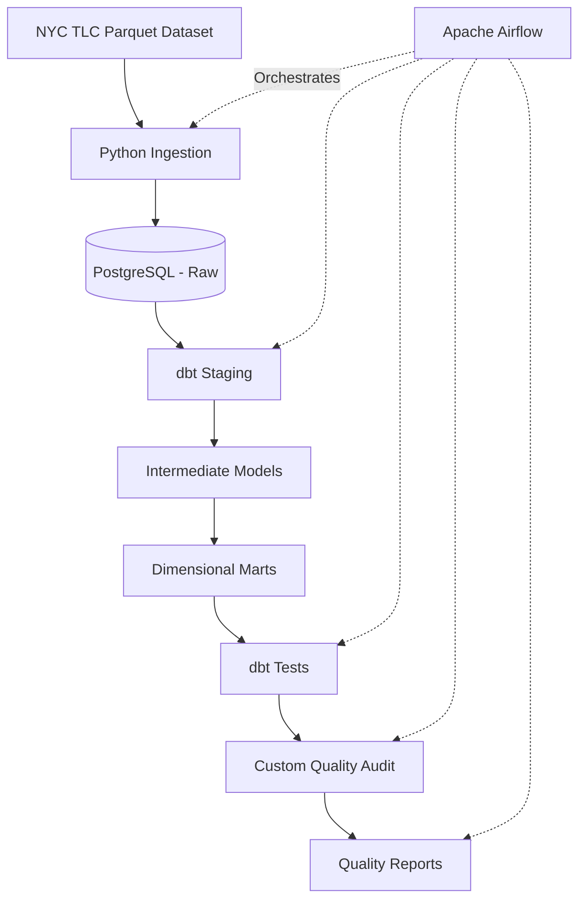
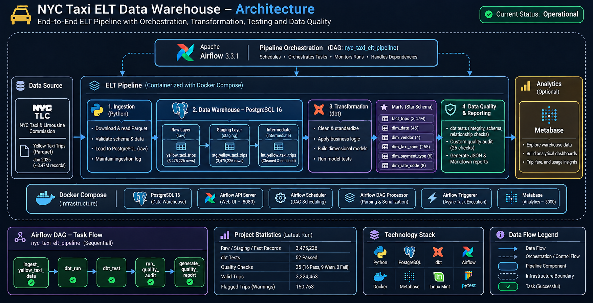
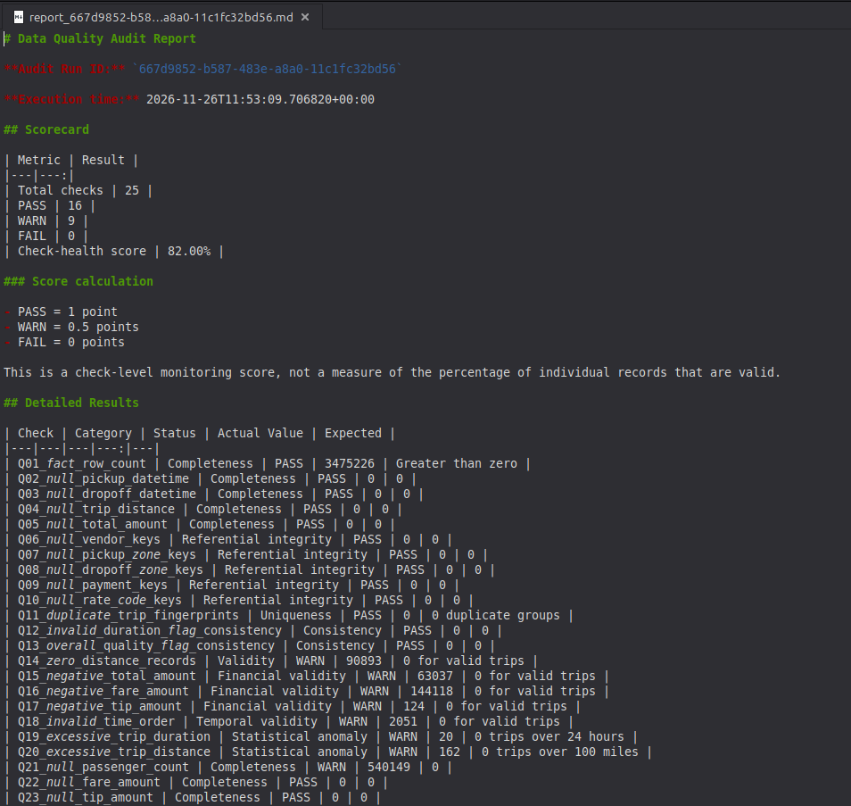
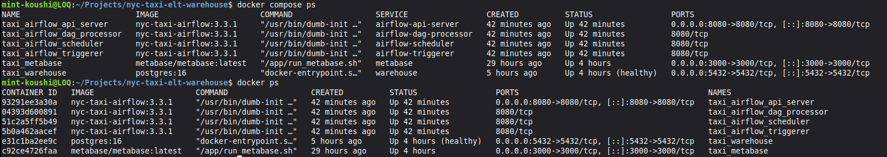

# NYC Taxi ELT Data Warehouse

[](https://www.python.org/)
[](https://www.postgresql.org/)
[](https://airflow.apache.org/)
[](https://www.getdbt.com/)
[](https://www.docker.com/)
[](https://linuxmint.com/)
[](#pipeline-orchestration)

An end-to-end ELT data warehouse project built around NYC Yellow Taxi trip data. The project ingests raw Parquet data into PostgreSQL, transforms it into a dimensional warehouse using dbt, validates data quality, and orchestrates the workflow through Apache Airflow.

---

## Overview

This project implements an end-to-end ELT pipeline using the January 2025 NYC Yellow Taxi dataset. It demonstrates data ingestion, warehouse modeling, automated testing, data-quality auditing, report generation, and pipeline orchestration.

The warehouse follows a layered architecture, separating raw data, staging transformations, intermediate models, analytical marts, and quality auditing.

### Architecture





---

## Technology Stack

| Technology | Purpose |
|---|---|
| Python | Data ingestion, validation and supporting scripts |
| PostgreSQL 16 | Data warehouse and storage |
| dbt | SQL transformations, dimensional modeling and testing |
| Apache Airflow 3 | Pipeline orchestration |
| Docker & Docker Compose | Containerized infrastructure |
| pytest | Testing Python ingestion functionality |
| SQL | Transformations, validation and analytical queries |
| Linux Mint | Development environment |
| Metabase | BI and analytics environment |

---

## Data Pipeline

The pipeline processes the NYC TLC Yellow Taxi trip dataset through the following stages:

### 1. Data Ingestion

- Downloads and processes the Yellow Taxi Parquet dataset.
- Loads data into PostgreSQL using Python and batch-oriented ingestion.
- Implements validation, transaction handling and idempotency.
- Maintains ingestion metadata.

### 2. Data Transformation

dbt transforms the raw dataset through multiple layers:

- **Staging:** Cleans and standardizes raw data types and fields.
- **Intermediate:** Applies business logic and prepares records for dimensional modeling.
- **Marts:** Creates fact and dimension tables for analytical workloads.

### 3. Data Warehouse Modeling

The warehouse uses a dimensional modeling approach with a fact table and supporting dimension tables.

Implemented models include:

- `fact_trips`
- `dim_date`
- `dim_vendor`
- `dim_taxi_zone`
- `dim_payment_type`
- `dim_rate_code`

The warehouse also contains additional supporting models and schemas for staging and intermediate transformations.

### 4. Testing & Data Quality

The project incorporates two layers of validation:

- **dbt tests:** Validate model integrity, relationships and data expectations.
- **Custom quality auditing:** Executes 25 SQL-based checks against the warehouse and persists audit results.

The quality framework identifies anomalies such as invalid time ordering, negative monetary values, zero-distance trips, excessive trip duration, and missing passenger counts.

Audit outcomes are classified as `PASS`, `WARN`, or `FAIL`.

### 5. Reporting

The quality framework generates:

- JSON audit results for individual runs.
- Markdown quality reports.
- A consolidated `latest_report.md` report.

---

## Pipeline Orchestration

Apache Airflow orchestrates the pipeline through a manually triggered DAG.

**DAG:** `nyc_taxi_elt_pipeline`

| Task | Description |
|---|---|
| `ingest_yellow_taxi_data` | Ingests source data into PostgreSQL |
| `dbt_run` | Executes dbt transformation models |
| `dbt_test` | Runs dbt data tests |
| `run_quality_audit` | Executes custom quality checks |
| `generate_quality_report` | Generates the quality report |

Tasks execute sequentially, with downstream tasks dependent on the successful completion of upstream tasks.


---

## Data Quality & Validation

### Warehouse Statistics

| Metric | Value |
|---|---:|
| Raw records ingested | 3,475,226 |
| Staging records | 3,475,226 |
| Fact table records | 3,475,226 |
| Valid trips | 3,324,463 |
| Flagged trips | 150,763 |
| dbt tests | 52 passed |
| Custom quality checks | 25 |

### Custom Quality Audit

The audit framework currently executes 25 checks covering:

- Null and completeness checks
- Duplicate trip fingerprints
- Key integrity
- Quality flag consistency
- Invalid trip durations
- Negative fares and total amounts
- Zero-distance records
- Excessive trip distance
- Missing passenger counts
- Unmapped pickup boroughs

The latest successful audit execution produced:

| Result | Count |
|---|---:|
| PASS | 16 |
| WARN | 9 |
| FAIL | 0 |

Warnings represent identified data anomalies and do not automatically cause pipeline failure.





---

## Repository Structure

```text
nyc-taxi-elt-warehouse/
├── airflow/
│   └── requirements.txt
├── config/
│   └── dbt/
│       └── profiles.yml
├── dags/
│   └── nyc_taxi_pipeline.py
├── dbt/
│   ├── models/
│   │   ├── staging/
│   │   ├── intermediate/
│   │   └── marts/
│   │   └── ...
│   └── ...
├── ingestion/
├── scripts/
│   └── quality/
├── reports/
│   └── quality/
├── tests/
├── Dockerfile.airflow
├── docker-compose.yml
└── README.md
```

---

## Infrastructure

The project runs using Docker Compose and includes:

- PostgreSQL warehouse
- Metabase
- Apache Airflow API server
- Airflow scheduler
- Airflow DAG processor
- Airflow triggerer

Airflow orchestrates the pipeline while PostgreSQL hosts the warehouse and metadata databases.




---

## Current Project Status

- [x] PostgreSQL warehouse infrastructure
- [x] Warehouse schemas and role-based access setup
- [x] Python-based data ingestion
- [x] Data validation and ingestion metadata
- [x] dbt staging and intermediate models
- [x] Dimensional warehouse modeling
- [x] dbt automated testing
- [x] Analytical SQL queries
- [x] Custom data-quality audit framework
- [x] JSON and Markdown report generation
- [x] Dockerized Apache Airflow infrastructure
- [x] Airflow DAG orchestration
- [x] Successful end-to-end pipeline execution

---

## Dataset

The project uses the NYC Taxi & Limousine Commission's publicly available Yellow Taxi trip data.

**Dataset:** January 2025 Yellow Taxi trip records

Source: [NYC TLC Trip Record Data](https://www.nyc.gov/site/tlc/about/tlc-trip-record-data.page)

---

## License

This project is intended for educational and portfolio purposes.

